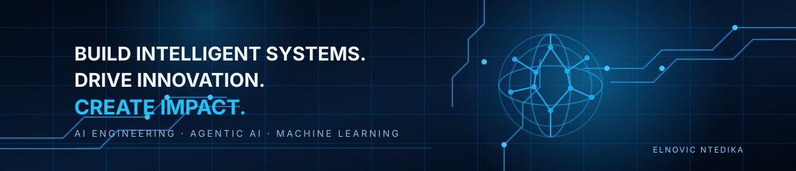

  

<!-- GitHub profile README | https://github.com/elnovic -->

# ELNOVIC NTEDIKA

### AI ENGINEER · MACHINE LEARNING · AGENTIC AI

**I build and deliver impactful AI solutions — from data analysis and machine learning to autonomous agents and intelligent applications.**

---

## Profile

I am an **AI Engineer** focused on designing, developing, and integrating intelligent systems that solve practical problems. I combine data analysis, machine learning, software development, and modern AI techniques to move from an idea to a working solution.

My work and experiments span:

- **AI Engineering:** LLM-powered applications, AI integration, and intelligent software.
- **Agentic AI:** autonomous and multi-agent workflows, tool execution, and orchestration.
- **Machine Learning & Data Science:** data preparation, exploratory analysis, predictive modelling, and evaluation.
- **Applied AI:** prototypes and products for education, research, architecture, music, and real-world decision support.

I also founded **NOVI Ecosystem**, an independent initiative exploring AI literacy and technology-driven social impact. It is one part of my broader work, not my professional title.

## Featured Projects

### [AI Tech Watch Agent](https://github.com/elnovic/AI-Tech-Watch-Agent)
An AI-assisted research monitoring system that retrieves academic publications from arXiv and Semantic Scholar, identifies relevant papers, and generates structured summaries with LLMs. The project explores research orchestration, traceability, data quality, and observability.

**Technologies:** Python, FastAPI, Streamlit, PostgreSQL, Redis, OpenAI API, Arize, Docker.

### [Autonomous AI DJ Agent](https://github.com/elnovic/-ia-dj-agent)
An experimental multi-agent system for adaptive music experiences. Separate agent roles handle music curation, playback and mixing logic, and user interaction. The project uses real audio data and an interactive demonstration to explore agent coordination.

**Focus:** multi-agent systems, audio processing, adaptive interaction.

### [Agent DJ — 3-Agent Plan](https://github.com/elnovic/AGENT-DJ-3-Plan)
A separate project track exploring a three-agent DJ architecture and its implementation. Kept distinct from the other AI DJ repository to reflect its own scope and development.

### [NOVI AI](https://github.com/elnovic/novi-ai)
An AI-enabled learning initiative with structured course content and educational resources, developed within the independent NOVI Ecosystem.

### [NOVI Ecosystem](https://github.com/elnovic/NoviEcosyst-me)
An independent initiative focused on AI literacy, African digital innovation, and technology with social impact.

## Technical Skills

**Programming & Data**
- Python, SQL, C, R
- Pandas, NumPy, Matplotlib
- Data analysis, data preparation, visualization

**AI & Machine Learning**
- Machine Learning, Deep Learning
- PyTorch, TensorFlow, scikit-learn
- NLP, LLM applications, RAG
- Agentic AI, multi-agent workflows, tool-using agents

**Engineering & Deployment**
- FastAPI, Streamlit, React, TypeScript
- PostgreSQL, Redis
- Docker, Git, API integration
- AI monitoring and evaluation

## Certifications & Continuous Learning

Selected credentials and learning paths include:

- **AI Agents Mastery** — Arize AI
- **NVIDIA NeMo Agent Toolkit: Making Agents Reliable** — DeepLearning.AI
- **Building Coding Agents with Tool Execution** — DeepLearning.AI
- **AI Security** — Securiti
- **Artificial Intelligence & Machine Learning Specialist** — LinkedIn Learning
- **Data Analysis with Python** — freeCodeCamp
- **Scientific Computing with Python** — freeCodeCamp

## Community

**DeepLearning.AI Event Ambassador** — contributing to AI knowledge-sharing and community events.

## Connect

- **LinkedIn:** [linkedin.com/in/elnovic-ntedika](https://www.linkedin.com/in/elnovic-ntedika/)
- **GitHub:** [github.com/elnovic](https://github.com/elnovic)

---

*Engineering intelligent systems. Turning data into decisions. Building useful AI.*

